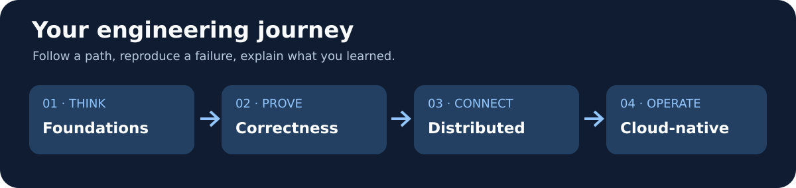

  

  # 📚 Engineering Handbook

  **Short notes. Real experiments. Better engineering judgment.**

  [🥋 The Dojo](https://github.com/the-engineering-dojo) · [🎟️ Reservation Engine](https://github.com/the-engineering-dojo/reservation-engine) · [🤝 Contribute](https://github.com/the-engineering-dojo/.github/blob/main/CONTRIBUTING.md)

---

## 👋 Start here

This is the **shared knowledge base** for The Engineering Dojo. We are learning software engineering together, not collecting buzzwords.

**Pick a question → read a short explanation → try an experiment → write what happened → discuss the trade-offs.**

### 🧭 Choose a learning path

| Start with... | You'll practice | Open |
| --- | --- | --- |
| 🧠 **Engineering foundations** | Modeling, boundaries, cohesion, SOLID, DDD | [Explore →](learning-paths/01-engineering-foundations.md) |
| 🔒 **Correctness & data** | ACID, isolation, race conditions, idempotency | [Explore →](learning-paths/02-reliable-data.md) |
| 📨 **Distributed systems** | Messaging, retries, outbox, consistency | [Explore →](learning-paths/03-distributed-systems.md) |
| 🐳 **Cloud-native** | Containers, Kubernetes, rollout, reliability | [Explore →](learning-paths/04-cloud-native.md) |
| 🧪 **Quality & evidence** | Testing, profiling, load tests, observability | [Explore →](learning-paths/05-testing-observability.md) |

📍 Not sure where to begin? Use the [learning paths overview](learning-paths/README.md).

### 🗂️ Explore by concept

| Topic | The key question |
| --- | --- |
| [🧩 DDD & boundaries](notes/ddd-and-boundaries.md) | Where do business rules belong? |
| [🔐 Transactions & concurrency](notes/concurrency-transactions.md) | How do we prevent invalid states under load? |
| [🔀 Microservices](notes/microservices-when-and-why.md) | When does splitting a service help—and hurt? |
| [☸️ Docker & Kubernetes](notes/docker-vs-kubernetes.md) | What changes when we replicate a service? |
| [🤖 Learning with AI](notes/ai-without-skill-atrophy.md) | How do we stay capable while using powerful tools? |

## 🧪 From reading to evidence

Every note should point to a testable question. Our first shared case study is [Reservation Engine](https://github.com/the-engineering-dojo/reservation-engine), where we will explore double booking, transactions, messaging, Docker, Kubernetes, and load testing—**in that order of learning need, not feature hype**.

## ✍️ Write a note or propose a challenge

- [📝 Learning note template](templates/learning-note.md)
- [🧪 Challenge template](templates/challenge.md)
- [📜 Lightweight decision record](templates/decision-record.md)
- [🔗 Curated official resources](resources/README.md)

**Status:** documentation and planning. These paths describe what we plan to practice; they are not certifications or completed achievements.